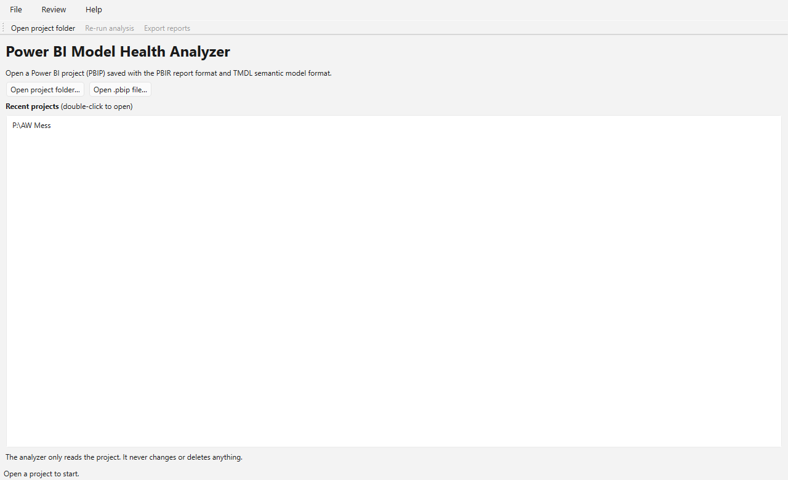
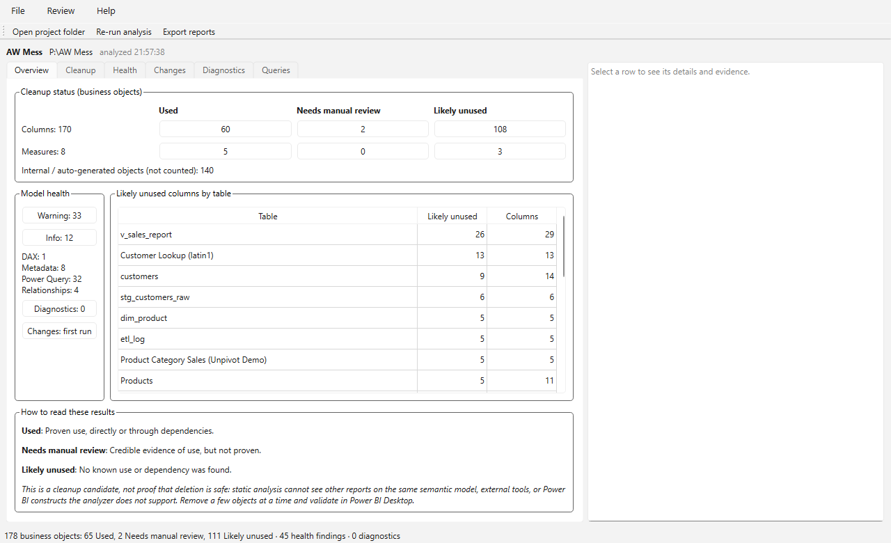
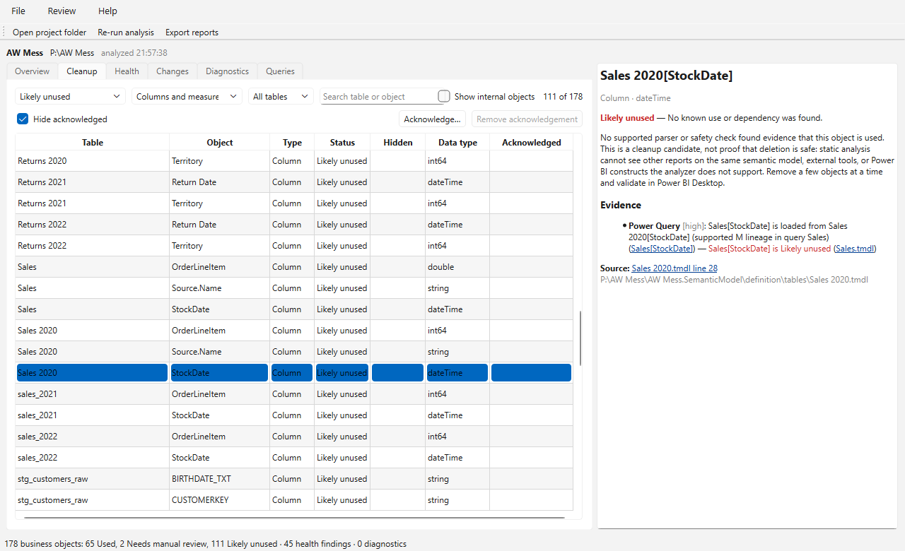
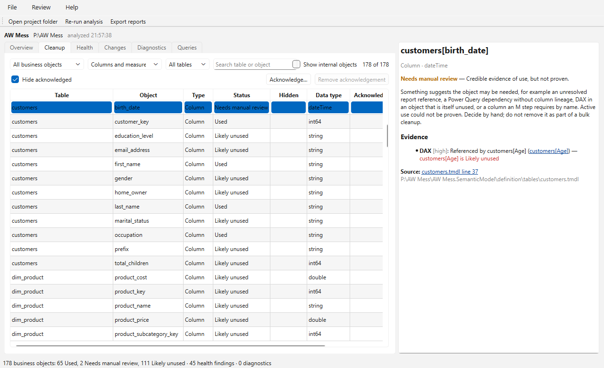
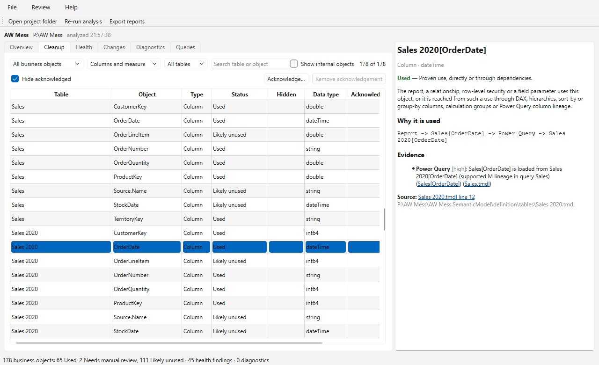
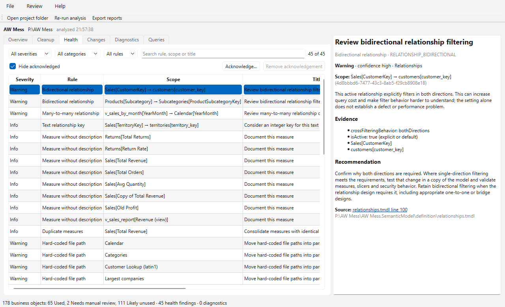
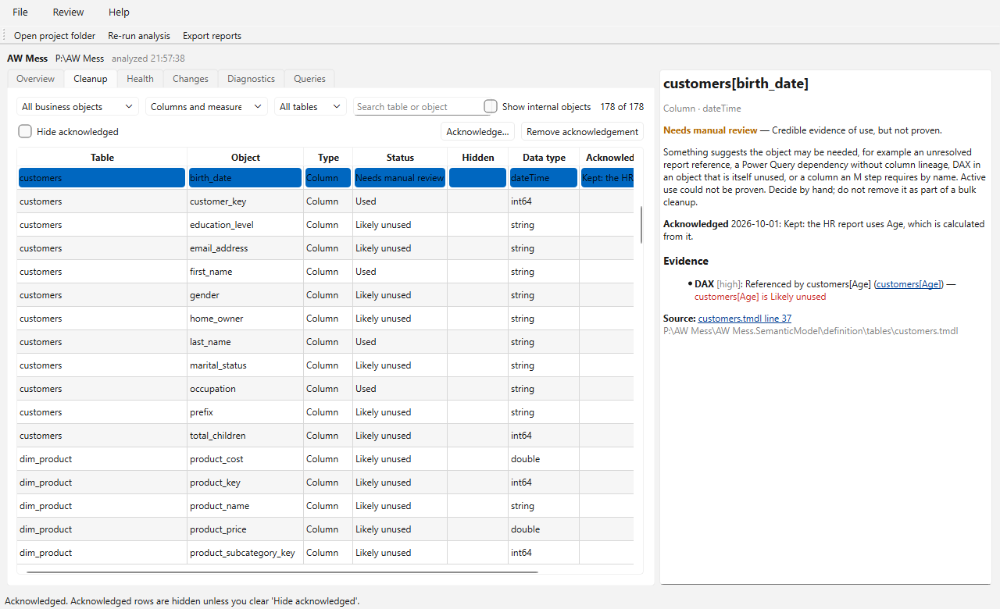
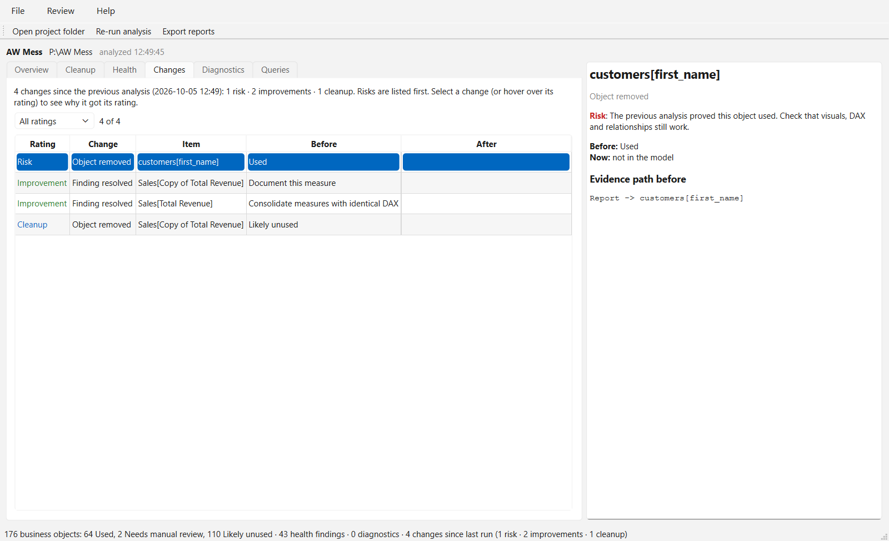
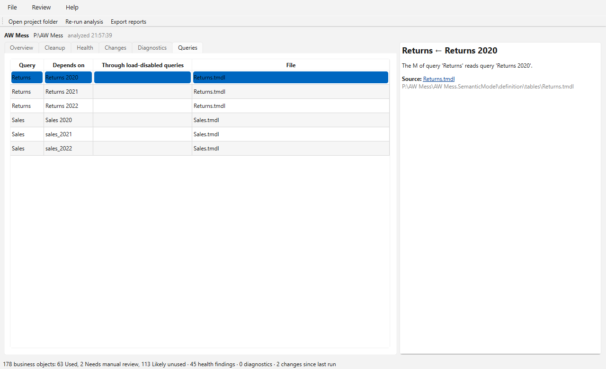

# Power BI Model Health Analyzer — User manual

This manual is for Power BI users who build or maintain reports and semantic
models. You do not need to know programming. It assumes you know Power BI
Desktop: tables, columns, measures, relationships, Power Query and visuals.

## Contents

1. [What the analyzer does](#1-what-the-analyzer-does)
2. [Before you start: save your report as a Power BI project](#2-before-you-start-save-your-report-as-a-power-bi-project)
3. [Install and start the app](#3-install-and-start-the-app)
4. [Open a project](#4-open-a-project)
5. [The Overview tab](#5-the-overview-tab)
6. [What the four statuses mean](#6-what-the-four-statuses-mean)
7. [The Cleanup tab](#7-the-cleanup-tab)
8. [Reading "Why it is used"](#8-reading-why-it-is-used)
9. [A safe way to clean up a model](#9-a-safe-way-to-clean-up-a-model)
10. [The Health tab](#10-the-health-tab)
11. [Acknowledging items you have reviewed](#11-acknowledging-items-you-have-reviewed)
12. [The Changes tab](#12-the-changes-tab)
13. [The Diagnostics and Queries tabs](#13-the-diagnostics-and-queries-tabs)
14. [Exporting reports](#14-exporting-reports)
15. [Ask Claude about your model](#15-ask-claude-about-your-model)
16. [What the analyzer cannot see](#16-what-the-analyzer-cannot-see)
17. [Privacy](#17-privacy)
18. [Troubleshooting](#18-troubleshooting)
19. [Glossary](#19-glossary)

---

## 1. What the analyzer does

Over time, semantic models collect columns, measures and queries that no visual
needs any more. They make the model larger, refresh slower and the field list
harder to use. Finding them by hand is slow and risky: a column that no visual
shows may still be needed by a measure, a relationship, a sort order or a Power
Query step.

The analyzer reads your Power BI project files and answers three questions:

- **Which columns and measures are used, and why?** It follows the whole chain:
  a visual uses a measure, the measure uses another measure, that measure uses a
  column, and the column is loaded from another query.
- **What can probably be removed?** Columns and measures with no known use are
  listed as cleanup candidates.
- **Are there common model problems?** For example bidirectional relationships,
  hard-coded file paths in Power Query, or measures without descriptions.

The analyzer **only reads** your project. It never changes, deletes or saves
anything in it. You make all changes yourself in Power BI Desktop.

It does not connect to your data sources and does not look at your data. It
works from the definitions Power BI saves: tables, columns, DAX, Power Query (M),
relationships and the report pages.

## 2. Before you start: save your report as a Power BI project

The analyzer reads **Power BI projects** (`.pbip`), not `.pbix` files. A project is
a folder of readable files that Power BI Desktop writes when you save in that
format. Your `.pbix` stays untouched; you create the project as an extra copy.

To create a project:

1. Open your report in Power BI Desktop.
2. Choose **File > Save as**, then **Browse this device**.
3. Pick a folder and choose **Save as type: Power BI project files (\*.pbip)**.
4. Click **Save**.

Power BI Desktop creates a `.pbip` file and two folders next to it, for example:

```
Sales Report.pbip
Sales Report.Report\
Sales Report.SemanticModel\
```

The analyzer needs the two modern formats that recent versions of Power BI
Desktop use by default:

- **PBIR** for the report: the `.Report` folder contains a `definition\pages`
  folder.
- **TMDL** for the semantic model: the `.SemanticModel` folder contains a
  `definition\tables` folder with `.tmdl` files.

If your version still lists these as preview features (**File > Options and
settings > Options > Preview features**), turn on *Store semantic model using TMDL
format* and *Store reports using enhanced metadata format (PBIR)*, then save the
project again. The analyzer tells you if it finds an older format (see
[Troubleshooting](#18-troubleshooting)).

> **Tip:** If the project is in a OneDrive or SharePoint folder that syncs,
> Power BI can occasionally fail to save while files are uploading. Pause
> syncing while you save if that happens.

## 3. Install and start the app

You receive the app as a zip file such as `PBI-Model-Health-2.0.0-win64.zip`.

1. Right-click the zip file and choose **Extract All…**. Choose a folder you can
   find again, for example `Documents\PBI Model Health`.
2. Open the extracted `PBI Model Health` folder and double-click
   **PBI Model Health.exe**.

No installation and no administrator rights are needed. Keep the `.exe` together
with the `_internal` folder next to it; the app needs both. To make starting it
easier, right-click the `.exe` and choose **Send to > Desktop (create shortcut)**.

> **"Windows protected your PC"?** The app is not digitally signed, so Windows
> SmartScreen may warn the first time. If you received the app from a trusted
> colleague, click **More info**, then **Run anyway**.

The app follows your Windows colour setting (light or dark mode).

## 4. Open a project



Click **Open project folder…** and choose the folder that contains the `.pbip`
file, or click **Open .pbip file…** and choose the `.pbip` file itself. Projects
you have opened before appear under **Recent projects**; double-click one to open
it again.

The analysis usually takes about a second. Then the results appear in tabs:

| Tab | What it shows |
| --- | --- |
| **Overview** | The big picture, with numbers you can click. |
| **Cleanup** | Every column and measure with its status. |
| **Health** | Model problems and improvement suggestions. |
| **Changes** | What changed since you last analyzed this project. |
| **Diagnostics** | Parts of the project the analyzer could not fully read. |
| **Queries** | Which Power Query queries read from which other queries. |

The panel on the right shows the details of whatever you select in a tab.

After you change the model in Power BI Desktop and save, press **F5** (or click
**Re-run analysis**) to analyze it again.

## 5. The Overview tab



- **Cleanup status:** how many columns and measures are *Used*, *Need manual
  review* or are *Likely unused*. Click a number to see exactly those objects in
  the Cleanup tab.
- **Internal / auto-generated objects:** the hidden date tables Power BI creates
  when *Auto date/time* is on. They are counted separately and are never
  cleanup candidates.
- **Model health:** how many warnings and informational findings there are. Click
  to open the Health tab filtered on them.
- **Diagnostics** and **Changes since last run:** click to open those tabs.
- **Likely unused columns by table:** where the cleanup potential is. Double-click
  a table to list its candidates.
- **How to read these results:** a short reminder of what the statuses mean.

## 6. What the four statuses mean

| Status | Meaning | What to do |
| --- | --- | --- |
| **Used** | The analyzer can prove that something needs it: a visual, a filter, a relationship, row-level security, a field parameter, or a chain that leads to one of these. | Keep it. |
| **Needs manual review** | There is a credible sign it may be needed, but the analyzer cannot prove it. | Check it yourself before you change anything. |
| **Likely unused** | The analyzer found no use and no dependency. | A cleanup candidate. Read [section 9](#9-a-safe-way-to-clean-up-a-model) before removing it. |
| **Internal / auto-generated** | Created by Power BI itself (auto date/time). | Nothing; manage it through Power BI's *Auto date/time* setting. |

**"Likely unused" does not mean "safe to delete".** The analyzer only sees this
one project. It cannot see other reports that connect to the same semantic model
(for example reports published to the Power BI service that use it as a shared
dataset), Excel workbooks using *Analyze in Excel*, or external tools. Only you
know whether those exist.

Typical reasons for **Needs manual review**:

- A column is referenced only by a measure or calculated column that is itself
  unused. The detail panel then says, for example, *customers[Age] is Likely
  unused*. If you remove that measure or calculated column, the column usually
  becomes Likely unused too.
- A report file mentions the field in a way the analyzer cannot fully interpret.
- A Power Query step needs the column by name (for example a *Changed type* or
  *Filtered rows* step). Removing the column would break the refresh, even if no
  visual shows it.
- Power Query reads a table in a way the analyzer cannot follow column by column.

## 7. The Cleanup tab



The Cleanup tab lists every column and measure. Use the controls at the top to
narrow the list:

- **Status:** for example *Likely unused* only.
- **Columns and measures:** show only columns or only measures.
- **All tables:** show one table.
- **Search:** type part of a table or object name.
- **Show internal objects:** include Power BI's automatic date tables.
- **Hide acknowledged:** hide items you have already reviewed (see
  [section 11](#11-acknowledging-items-you-have-reviewed)).

Click a column header to sort. Click a row to see its details on the right:

- the status and what it means;
- **Why it is used** or **Why it needs review** (see the next section);
- **Evidence:** every piece of information that points at this object, such as
  *DAX: referenced by Sales[Total Revenue]*. Underlined names are links: click
  one to jump to that object;
- **References:** what this object itself uses, for example the columns a
  measure reads, or the query a column is loaded from. These are links too, so
  you can follow a chain step by step;
- **Source:** the model file and line where the object is defined. Click it to
  open the file.



## 8. Reading "Why it is used"

For every *Used* object the detail panel shows the shortest chain that proves it
is used. Read it from left to right:



```
Report -> Sales[OrderDate] -> Power Query -> Sales 2020[OrderDate]
```

means: a visual in the report uses `Sales[OrderDate]`, and Power Query loads that
column from `Sales 2020[OrderDate]` (here, `Sales` appends the yearly tables). So
`Sales 2020[OrderDate]` is needed even though no visual shows it directly.

The words between the arrows say how one step needs the next:

| Word | Meaning |
| --- | --- |
| **Report** | A visual, filter, slicer, tooltip or drillthrough uses the object. |
| **DAX** | A measure or calculated column refers to it. |
| **Relationship** | It is a key in an active or inactive relationship. |
| **Hierarchy** | It is a level of a hierarchy that is used. |
| **Sort by** | A used column is sorted by it (*Sort by column*). |
| **Group by** | Power BI groups another column by it (field parameters use this). |
| **Field parameter** | A field parameter includes it. |
| **Row-level security** | A security role's filter uses it. |
| **Calculation group** | A calculation item refers to it. |
| **Power Query** | A used column is loaded from it through Power Query steps. |

## 9. A safe way to clean up a model

1. **Keep a copy.** Work on a copy of the project, or use version control
   (for example Git) if your team has it.
2. **Check the scope.** Make sure no other report or workbook uses the same
   semantic model, or check those too.
3. **Start small.** In the Cleanup tab, filter on *Likely unused* and pick a
   handful of objects, preferably from one table.
4. **Remove them in Power BI Desktop.** For columns that come from your data
   source, removing them in Power Query (*Remove columns* or *Choose columns*)
   also makes the refresh lighter.
5. **Refresh and test.** Refresh the model and click through the report pages.
   Check that visuals, filters, slicers and drillthrough still work.
6. **Save and re-run.** Save the project and press **F5** in the analyzer. The
   **Changes** tab shows what changed.
7. **Repeat** with the next handful.

Leave **Needs manual review** objects for last, and decide each one
deliberately. When you decide to keep something, acknowledge it with a note
(section 11) so you do not have to think about it again.

## 10. The Health tab



The Health tab lists possible problems in the model. Each finding has:

- a **severity**: *Warning* (worth fixing in most models) or *Info* (an
  improvement opportunity);
- a **confidence**: how sure the analyzer is that it detected the situation
  correctly. It does not say how serious the issue is for your model;
- in the detail panel: what was found, why it may matter, the evidence, a
  concrete recommendation and where to find it.

Filter by severity, category or rule, or search. The findings are suggestions
based on common best practice. Some designs need, for example, a bidirectional
relationship; then acknowledge the finding with a note explaining why.

| Finding | What it means | Typical fix |
| --- | --- | --- |
| **Bidirectional relationship** | A relationship filters in both directions. That can make filtering ambiguous and slower. | Use single direction unless the design really needs both. |
| **Many-to-many relationship** | Both sides of a relationship can have repeated key values. | Check whether a bridge table or a different grain is better. |
| **Text relationship key** | A relationship joins on a text column. | Consider a whole-number key, especially on large tables. |
| **Measure without description** | A measure has no description, so report authors see no help text in the field list. | Add a description in the measure's properties. |
| **Reference to a missing object** | DAX refers to a column or measure that does not exist (often after a rename). The measure will show an error. | Correct the reference or remove the measure. |
| **Duplicate measures** | Several measures have exactly the same DAX. | Keep one and point visuals at it. |
| **Hard-coded file path** | Power Query reads from a fixed path such as `C:\Users\…`. Refresh fails on other computers and in the service. | Use a parameter or a shared location. |
| **Local server name** | Power Query connects to `localhost` or similar. That only works on your own computer. | Use the real server name. |
| **Loaded append input** | A query is appended into another table *and* loaded itself, so its rows are imported twice. | Turn off *Enable load* for the input query. |
| **Hard-coded yearly append** | A query appends separate queries per year, such as *Sales 2023* and *Sales 2024*. | Load the years from one folder, table or parameterized source. |
| **Unfiltered folder source** | A folder is combined without selecting which files to read, so a stray file in the folder ends up in the model. | Filter the files by name or extension before combining. |

## 11. Acknowledging items you have reviewed

When you have looked at a cleanup candidate or a health finding and decided to
keep it, **acknowledge** it:

1. Select the row in the Cleanup or Health tab.
2. Click **Acknowledge…** (or press **Ctrl+K**).
3. Optionally write a note, for example *"Kept: used by the finance team's Excel
   workbook"*, and click **OK**.



Acknowledged rows are hidden while **Hide acknowledged** is ticked, so your lists
get shorter as you work. Untick it to see them again; the note appears in the
*Acknowledged* column and in the detail panel. Acknowledgements are kept when you
re-run the analysis or restart the app.

To undo, select the row and click **Remove acknowledgement**
(**Ctrl+Shift+K**). **Review > Remove acknowledgements of missing items** cleans
up acknowledgements for objects or findings that no longer exist.

Acknowledgements are stored on your computer for your Windows user only; they
are not saved in the project and not shared with colleagues.

## 12. The Changes tab



Every time you analyze a project, the analyzer remembers the result. The
**Changes** tab compares the current result with the previous analysis of the
same project, even if you closed the app in between. It lists:

- objects whose **status changed**, with the status before and now;
- **new** and **removed** objects;
- health findings that are **new** or **resolved**.

Each change gets a **rating**, and the most serious ones are listed first:

| Rating | Meaning | Examples |
| --- | --- | --- |
| **Risk** | Something that was in use was removed, or now refers to a missing object. Check it first. | You deleted a column the report uses; a measure now refers to a column that no longer exists. |
| **Attention** | Possibly unintended. | An object lost its last use; a new health finding; a removed object that needed manual review. |
| **Improvement** | A health finding no longer occurs. | You consolidated duplicate measures. |
| **Cleanup** | A Likely unused object was removed. | Still refresh and check your visuals. |
| **Neutral** | No action needed. | A new measure that the report already uses. |

The line above the table counts the ratings, and the list next to it shows only
one rating at a time. Select a change to see why it got its rating and the
evidence the object had before, for example `Report -> customers[first_name]`. In
the screenshot, a duplicate measure was removed (a cleanup that also resolved two
health findings), but so was a column a visual still shows: that is a risk.
If the Overview tab shows **Risks among the changes**, click it to list just those.

Use the Changes tab after each cleanup round (section 9) to confirm that only
what you expected changed. If you use Claude Desktop (section 15), Claude sees the
same ratings when you ask it to evaluate your changes.

## 13. The Diagnostics and Queries tabs

**Diagnostics** lists parts of the project the analyzer could not fully read or
trace, for example a damaged file or a Power Query expression it cannot follow
column by column. When there are diagnostics, a yellow bar appears above the
tabs: treat the results as incomplete and review affected objects with extra
care. The analyzer is designed to answer *Needs manual review* rather than
*Likely unused* when it is unsure.



**Queries** lists which Power Query queries read from which other queries, for
example `Sales ← Sales 2020`. If a query reads another through a query that is
not loaded into the model, that path is shown too.

## 14. Exporting reports

**File > Export reports…** (**Ctrl+E**) saves two files in a folder you choose:

- a **text summary** (`…_usage_summary_v2.txt`), easy to read and share;
- an **Excel workbook** (`…_usage_analysis_v2.xlsx`) with a sheet per topic, the
  evidence for every object and the *Evidence path* column.

**File > Export reports with JSON…** also saves a JSON file for automation. It
contains file paths and your model's DAX and Power Query code; share it only with
people who may see that.

The text summary lists the cleanup candidates by table, the Likely unused columns
and measures, every object that needs review with the reason, and the health
findings grouped by rule (one line per finding). The Excel workbook has the full
explanations and recommendations.

### Writing reports automatically

Tick **File > Write reports automatically** to have the app write the text summary
and the Excel workbook into the project folder (next to the `.pbip` file) every
time it analyzes the project, including each re-run with **F5**. The setting is
remembered. If a report file is open in Excel, the status bar says the reports
could not be written; close the file and press F5.

### Reports without opening the app

The app folder also contains **pbi-model-health-cli.exe**, which writes the same
reports without opening a window:

- **Drag and drop:** drag a project folder (or its `.pbip` file) onto
  `pbi-model-health-cli.exe`. A window shows a short summary, the reports are
  written into the project folder, and you press **Enter** to close the window.
- **Command prompt:** for one or several projects at once, optionally into one
  folder:

  ```
  "C:\Tools\PBI Model Health\pbi-model-health-cli.exe" "C:\Reports\Sales" "C:\Reports\Finance" --out "C:\Reports\Health checks"
  ```

  Add `--json` for the JSON file too. Run it with `--help` for all options. It
  also works in a scheduled task or a batch file; it finishes with exit code 0 when
  every project was analyzed and 1 otherwise.

## 15. Ask Claude about your model

If you use the **Claude Desktop** app, you can connect the analyzer to it and talk
about your model in plain language: what the findings mean, what to do first, and
whether your changes made the model better. Claude reads the analyzer's results;
the analyzer still decides every status and finding.

You need Claude Desktop on the same PC, and your organization must allow
extensions in it. If you are unsure, ask your IT department.

### Install the extension (once)

1. Start Claude Desktop.
2. Double-click **PBI-Model-Health-*version*.mcpb** (it comes with the app), or
   drag it into the Claude Desktop window.
3. Check the details in the dialog and click **Install**.

The extension contains its own copy of the analyzer, so it works even if the app
folder is somewhere else. To switch it off or remove it, open Claude Desktop's
**Settings > Extensions**.

### Ask about a project

Tell Claude where the project is, for example:

> Analyze my Power BI project at C:\Reports\Sales and tell me what matters most.

Claude asks your permission each time it wants to use one of the analyzer's tools;
you can allow it once or for the whole chat. Good follow-up questions:

- *Why is Sales[Discount] Likely unused?*
- *Which three changes would improve this model most?*
- *Explain the Power Query findings for someone new to the model.*

Ready-made requests are in the **+** menu of the chat box, under **Power BI Model
Health Analyzer**: **Interpret the analysis**, **Suggest next steps** and
**Evaluate my changes**. Choose one, enter the project's folder in
**project_path** (and, if you like, a question), and send.

### Check your changes

1. Before you change the model, ask Claude to **save a baseline** for the project.
2. Make your changes in Power BI Desktop and **save** the project (**Ctrl+S**); the
   analyzer reads the saved files.
3. Ask Claude to **compare with the baseline**, or choose **Evaluate my changes**.

The comparison marks each change as a *risk*, something that needs your
*attention*, an *improvement*, a *cleanup* or *neutral*. Risks come first, for
example a removed column that the report was using.

### Keep in mind

- Claude's suggestions are advice. Never delete an object only because Claude
  suggested it: the rules in [section 9](#9-a-safe-way-to-clean-up-a-model) still
  apply.
- What Claude receives: the analyzer's results, which include table, column and
  measure names, findings, file paths, server names and your DAX and Power Query
  code. They are sent to Claude as part of your conversation, under your
  organization's agreement for Claude.
- The analyzer itself only reads the project and never changes it.

## 16. What the analyzer cannot see

The analyzer works from the saved project files of one report. It cannot see:

- **other reports and workbooks** that use the same semantic model (in the
  Power BI service, Excel *Analyze in Excel*, paginated reports or other tools);
- your **data**: it does not know whether a column is empty, how many distinct
  values it has, or whether a file contains duplicates;
- anything that is built **dynamically** at run time, or Power BI features it
  does not support yet. In those cases it errs on the side of *Needs manual
  review*.

It is a helpful assistant, not a guarantee. Always refresh and test after
removing objects.

## 17. Privacy

- The app works **offline**. It does not send your project, results or usage data
  anywhere. If you connect it to Claude Desktop, the results you let Claude use
  are sent to Claude by Claude Desktop (see [section 15](#15-ask-claude-about-your-model)).
- It does not connect to your data sources and needs no passwords.
- It writes files only when you export reports, plus a small file per project
  with your acknowledgements and the last result (for the Changes tab). That file
  is stored for your Windows user in
  `%APPDATA%\pbi-usage-analyzer\Power BI Model Health Analyzer\projects`. Delete
  that folder to forget all saved review information. Baselines saved through
  Claude Desktop are in the `assistant` folder next to it.

## 18. Troubleshooting

**"Could not analyze the project".** Make sure you chose the folder that contains
the `.pbip` file and its `.Report` and `.SemanticModel` folders, or the `.pbip`
file itself.

**"The semantic model … is saved as model.bim".** The model was saved in an
older format. Turn on *Store semantic model using TMDL format* (see
[section 2](#2-before-you-start-save-your-report-as-a-power-bi-project)) and
save the project again.

**A yellow bar says the report is in the legacy format.** The report was saved
in the older format (a single `report.json`). The analyzer then cannot read the
visuals properly; fields it finds mentioned get *Needs manual review*. Turn on
the PBIR format (section 2) and save the project again before you trust *Likely
unused* results.

**Almost everything is Likely unused.** Check the Diagnostics tab and the yellow
bar first. If the report part of the project is missing or in an old format, the
analyzer cannot see what the visuals use.

**My latest changes do not show.** Save the project in Power BI Desktop first,
then press **F5** in the analyzer.

**The project is in OneDrive and opening is slow or fails.** OneDrive may not
have downloaded the files yet. Right-click the project folder and choose
**Always keep on this device**, then try again.

**Windows blocks the app.** See the SmartScreen note in
[section 3](#3-install-and-start-the-app).

## 19. Glossary

| Term | Meaning |
| --- | --- |
| **PBIP** | Power BI project: a report saved as a folder of readable files instead of one `.pbix` file. |
| **PBIR** | The modern file format for the report part of a project (pages and visuals as separate files). |
| **TMDL** | The modern file format for the semantic model part of a project (one file per table). |
| **Semantic model** | Tables, columns, measures and relationships behind a report (formerly called *dataset*). |
| **Power Query / M** | The query editor and language that load and shape data before it reaches the model. |
| **Append** | A Power Query step (*Append queries*) that stacks tables, for example several years. |
| **Load disabled** | A Power Query query with *Enable load* turned off: it feeds other queries but is not a table in the model. |
| **DAX** | The formula language of measures and calculated columns. |
| **Auto date/time** | A Power BI option that creates a hidden date table for every date column. |
| **Evidence path** | The chain of steps that shows why an object is used. |
| **Acknowledge** | Mark an item as reviewed so it stops asking for attention. |
